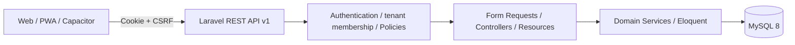

# FCMS PRO — Kiến trúc

Modular monolith Laravel 12 / PHP 8.2+ (production PHP 8.4), MySQL 8.4; frontend HTML/CSS/Vanilla JavaScript ES modules + Vite. Không dùng framework frontend hoặc TypeScript. Tài liệu thiết kế này được lập trước implementation.

`users` là danh tính toàn hệ thống; `club_members` là quyền truy cập theo CLB. `player_profiles` là hồ sơ nhân sự, có thể chưa liên kết tài khoản. CRUD hồ sơ không cấp quyền đăng nhập. Có đúng ba actor cấp cao: System Admin, Club Manager, Club Member; chức danh quản lý là role của membership. Cờ system admin không vượt tenant policy.

Mỗi request tenant resolve CLB qua membership active, sau đó resolve tài nguyên con trong CLB, chạy Policy và validation. Người ngoài nhận 404; người trong thiếu quyền nhận 403. Lấy club_id từ CLB đã được xác thực; không tin club_id gửi từ client. Composite FK `(club_id,team_id)` ngăn profile liên kết đội khác tenant.

Sanctum dùng session cookie, CSRF, regenerate session sau login/register, invalidate khi logout. Vite proxy `/api`, `/sanctum` tới Laravel cùng origin. Không lưu token trong localStorage. Native auth là gate riêng trước release mobile.

Lát cắt đầu: đăng ký/đăng nhập/đăng xuất/hồ sơ; nhiều CLB; tạo/cập nhật CLB; đội; CRUD nhân sự; lời mời một lần; dashboard số đếm thật; audit thay đổi. Xem trạng thái kiểm chứng tại [PROGRESS](../PROGRESS.md). Phase 1 tổng thể còn Excel, hồ sơ nâng cao và các luồng tài khoản.

Tài chính, kho, bóng đá và module nâng cao là PLANNED, triển khai tuần tự theo [ROADMAP](./ROADMAP.md). Không có API giả hoặc seed tài khoản production. Queue/scheduler/notifications dùng Laravel conventions khi đến module tương ứng.
