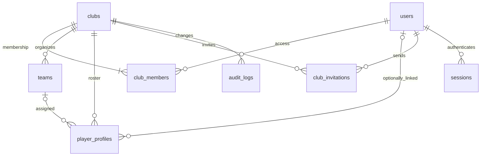
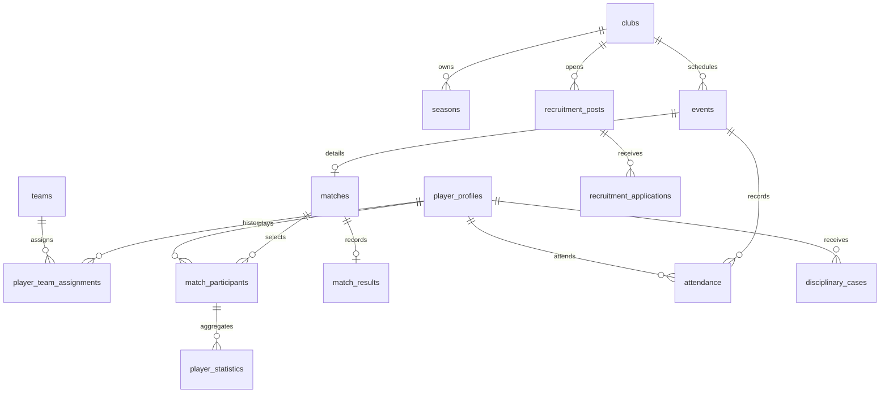
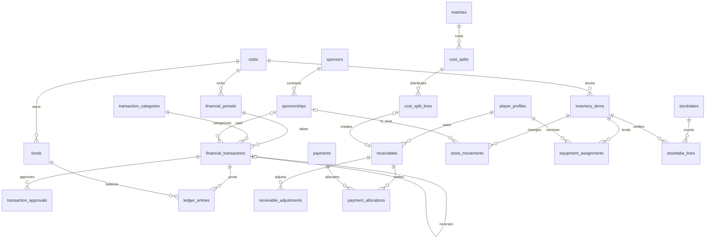
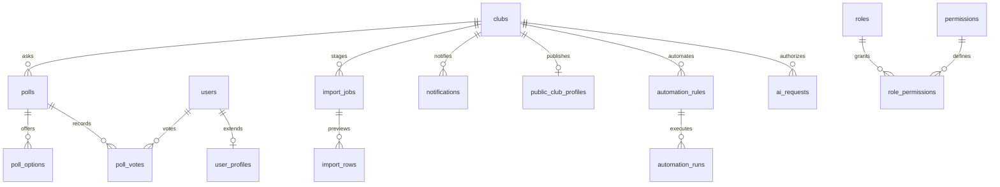

# ERD toàn hệ thống

Thiết kế trước implementation. Nhóm core được triển khai trước; các nhóm PLANNED chưa có migrations. Migration là nguồn chuẩn cho chi tiết field/index.

Core constraints: unique users.email, clubs.slug, club_members(club_id,user_id), teams(club_id,name), teams(club_id,id); profile composite FK `(club_id,team_id)`; invitation token SHA-256 unique, expiry and accepted_at; roles belong to membership. Roster profiles and access memberships are separate entities. Club creation + owner membership + audit share a transaction.

## Football / people — PLANNED

RSVP separate from actual attendance; unique attendance(club_id,event_id,player_id). Statistics derive from recorded results/events. Personal birthdays require privacy controls.

## Finance / inventory — PLANNED

Amounts DECIMAL, exact arithmetic, no float. Ledger is append-only after posting. Internal transfers excluded from external income/expense totals. Payment confirmation is manual until bank verification exists. Period locks, row locks, idempotency and reversal are required and must be tested before finance acceptance.

## Other modules — PLANNED

Roles initially fixed enums; configurable permission tables are a future evolution. Poll unique(club_id,poll_id,user_id). Import stages mapping/preview/errors and writes only after explicit confirm. AI requires explicit data-processing configuration; never changes balances or approves payments. Every planned tenant table must include club_id, scoped indexes and composite FK on cross-resource relations.
